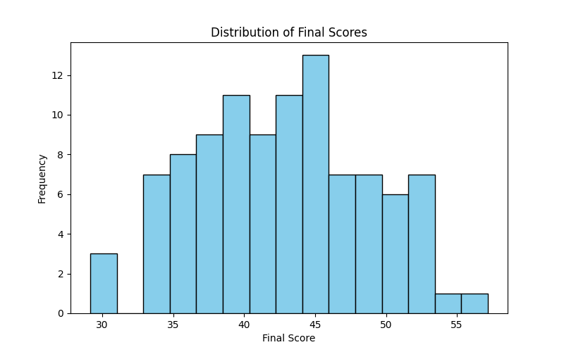
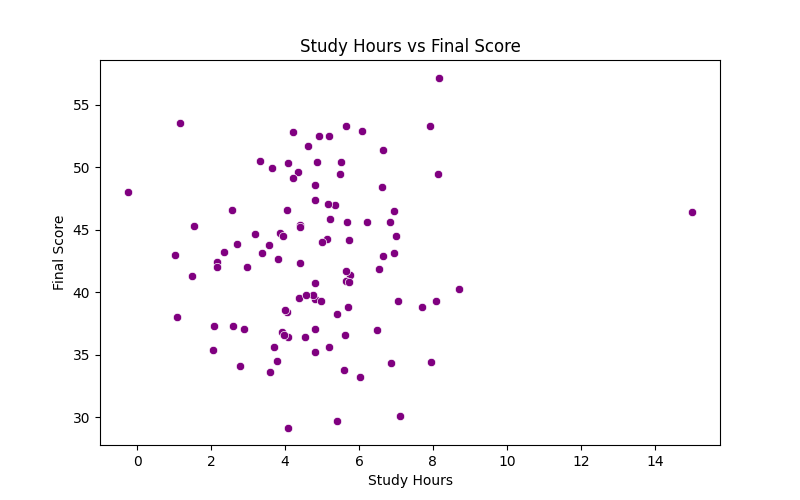

# ML Lab 1: Student Score Analysis

This repository contains data analysis exploring the relationship between student study hours, attendance, previous marks, and final scores.

## Visualizations

### Final Score Distribution

### Study Hours vs Final Score

